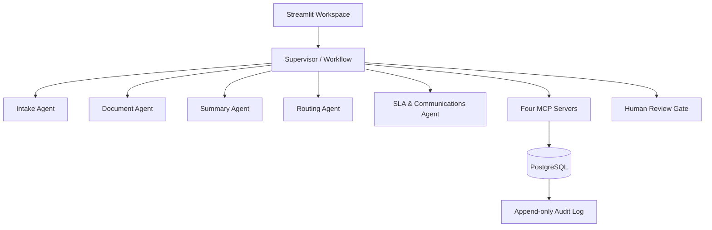

# Architecture

The current scaffold exposes four FastMCP tool servers and specialist Python modules. The workflow is orchestrated through a dependency-light supervisor function. LangGraph checkpointing/interrupt resume is a planned integration, not claimed as complete. PostgreSQL persistence is used by the Streamlit claim flow. Model calls are optional and default disabled. Human approval is mandatory; AI must not decide claim outcomes.
